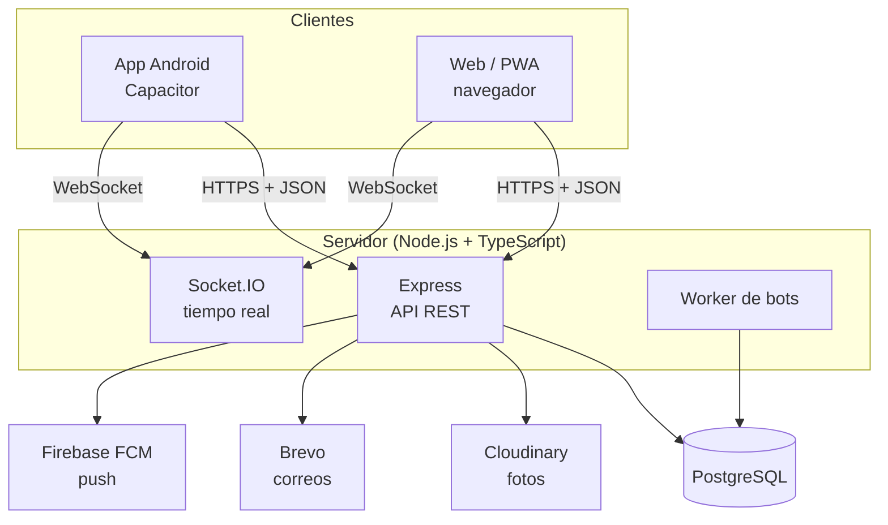
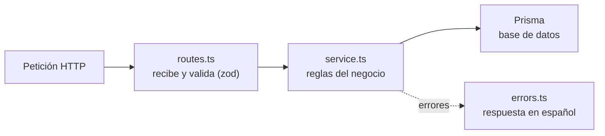
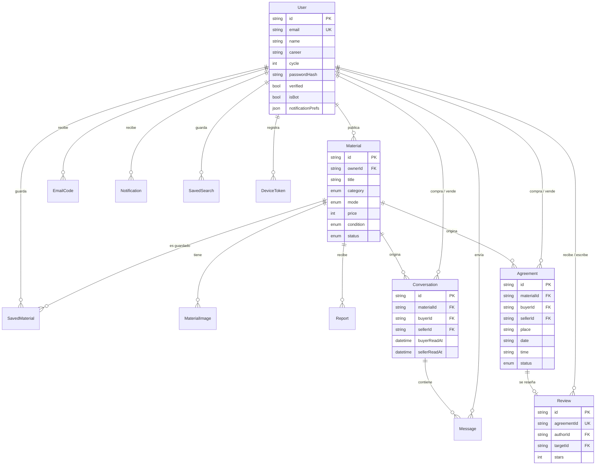
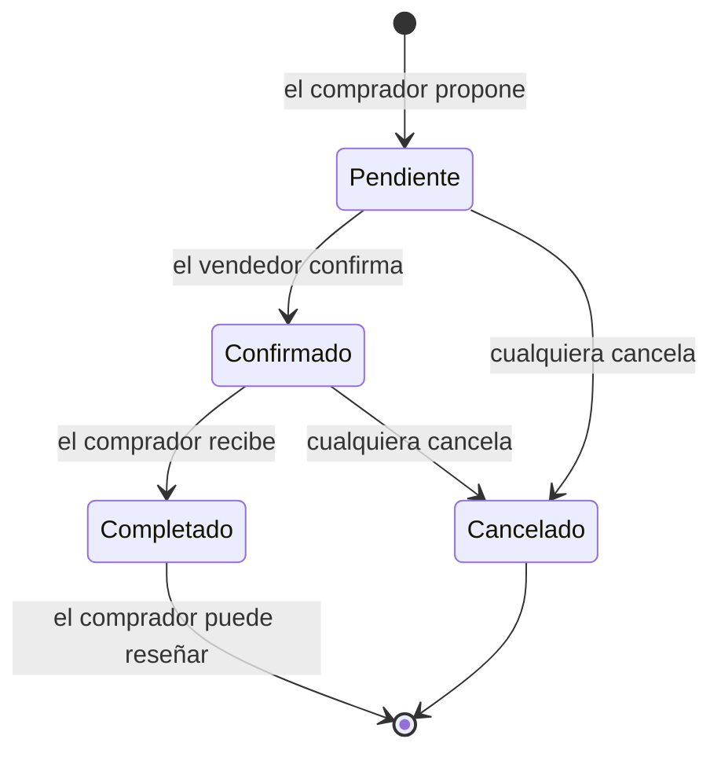
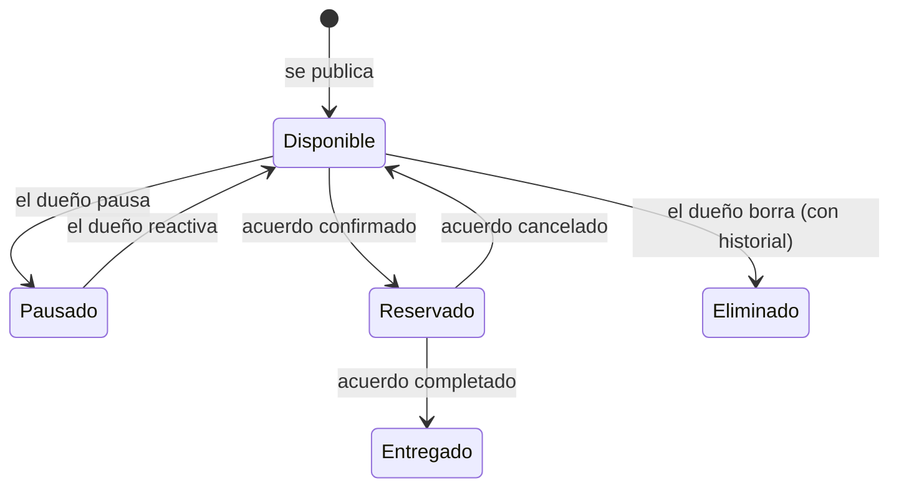
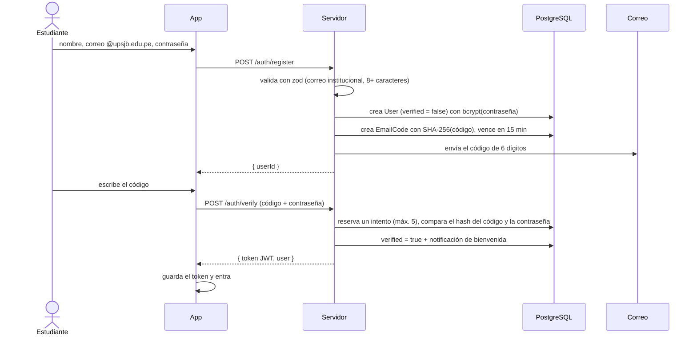
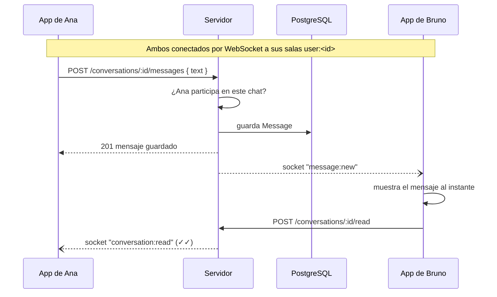
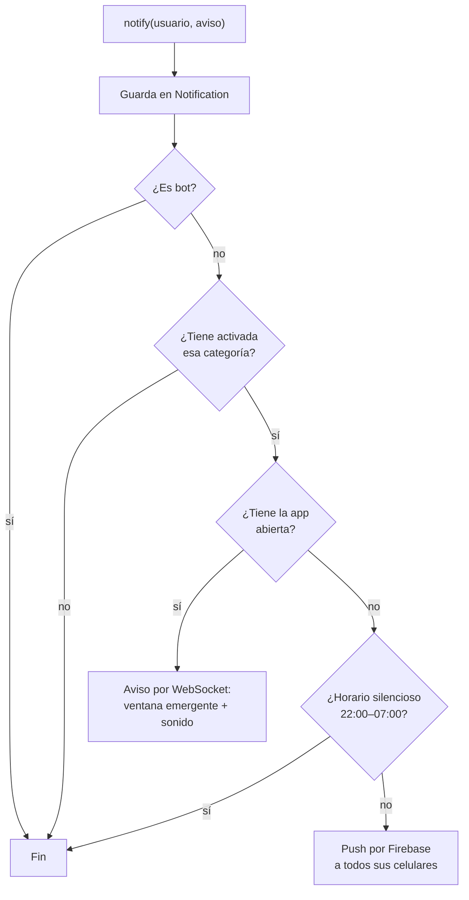

# El backend de EcoEstudiante, explicado

Documento de apoyo para la sustentación. Explica **qué** se construye, **cómo** funciona cada parte y **por qué** se
tomó cada decisión. El detalle técnico exacto está en el spec
(`docs/superpowers/specs/2026-11-09-backend-design.md`) y en los planes de implementación (`docs/superpowers/plans/`).

> **Estado:** las 5 etapas están construidas y el servidor está publicado en https://ecoestudiante-api.onrender.com. Funciona el registro con correo real, las publicaciones con fotos en la nube, el chat en tiempo real, los acuerdos, las reseñas, los estudiantes simulados y los avisos push con la app cerrada. Se probó en un celular real con el APK 2.0.

## Índice

1. [El problema y la solución](#1-el-problema-y-la-solución)
2. [Vista general de la arquitectura](#2-vista-general-de-la-arquitectura)
3. [Tecnologías y por qué se eligieron](#3-tecnologías-y-por-qué-se-eligieron)
4. [Organización del código](#4-organización-del-código)
5. [La base de datos](#5-la-base-de-datos)
6. [La API REST](#6-la-api-rest)
7. [Flujos principales paso a paso](#7-flujos-principales-paso-a-paso)
8. [Seguridad](#8-seguridad)
9. [Pruebas](#9-pruebas)
10. [Etapas de construcción](#10-etapas-de-construcción)
11. [Cómo ejecutarlo y desplegarlo](#11-cómo-ejecutarlo-y-desplegarlo)
12. [Decisiones y alternativas descartadas](#12-decisiones-y-alternativas-descartadas)
13. [Limitaciones conocidas y mejoras futuras](#13-limitaciones-conocidas-y-mejoras-futuras)
14. [Preguntas probables en la sustentación](#14-preguntas-probables-en-la-sustentación)

---

## 1. El problema y la solución

**Antes.** La primera versión de EcoEstudiante era un prototipo **sin servidor**: todo se guardaba en la memoria del
propio celular (`localStorage`). Eso permitía recorrer la app, pero tenía límites de fondo:

- Cada celular veía **solo sus propios datos**. Dos estudiantes no podían ver las publicaciones del otro ni chatear entre sí.
- El código de verificación del correo **no se enviaba**: se mostraba en pantalla.
- La contraseña se "protegía" en el propio celular, donde cualquiera con acceso al dispositivo podía leer los datos.
- Los demás estudiantes eran **simulados** dentro del celular.

**Después.** Se construye un **servidor propio** al que se conectan la app de Android y la web. El servidor:

- guarda todos los datos en una **base de datos PostgreSQL** compartida,
- envía de verdad el **código de verificación** al correo `@upsjb.edu.pe`,
- guarda las **fotos** de los materiales en la nube,
- entrega los **mensajes del chat al instante** (WebSockets),
- envía **notificaciones push** aunque la app esté cerrada (Firebase),
- y mantiene a los **estudiantes simulados** (bots) para que la demo se vea viva con pocos usuarios reales.

**Restricciones del proyecto:** es una entrega académica, con pocos usuarios reales (compañeros y docente), **costo
cero** y un backend que el autor pueda **explicar entero**.

---

## 2. Vista general de la arquitectura



Hay **tres formas de comunicación**, cada una con un propósito:

| Canal | Dirección | Para qué |
|---|---|---|
| **API REST** (HTTP + JSON) | App → servidor | Todo lo que *pide* o *cambia* datos: iniciar sesión, publicar, enviar un mensaje, proponer una entrega |
| **WebSocket** (Socket.IO) | Servidor → app | *Avisar al instante* a una app abierta: llegó un mensaje, confirmaron tu entrega |
| **Push** (Firebase) | Servidor → celular | Avisar cuando la app está **cerrada** |

El servidor es **un solo proceso** que atiende la API, los WebSockets y el worker de los bots. Para la cantidad de
usuarios del proyecto es más que suficiente y mucho más simple de desplegar que varios servicios.

---

## 3. Tecnologías y por qué se eligieron

| Tecnología | Qué hace | Por qué |
|---|---|---|
| **Node.js + TypeScript** | Lenguaje del servidor | Es el mismo lenguaje del frontend, así que se comparten tipos y constantes. TypeScript detecta errores antes de ejecutar |
| **Express 5** | Framework HTTP | El más usado de Node, simple y fácil de explicar: *ruta → controlador → servicio* |
| **PostgreSQL** | Base de datos relacional | Los datos son muy relacionales (usuarios, materiales, conversaciones, acuerdos). Garantiza integridad con claves foráneas y restricciones |
| **Prisma** | ORM: conecta el código con la base | El archivo `schema.prisma` se lee como un diagrama de la base de datos. Genera las migraciones SQL y da tipos automáticos |
| **zod** | Validación de datos | Cada petición se valida contra un esquema antes de tocar la base de datos |
| **bcrypt** | Hash de contraseñas | Algoritmo diseñado para contraseñas: lento a propósito, con *salt* por usuario |
| **JWT** | Sesiones | Token firmado que la app envía en cada petición. El servidor no necesita guardar sesiones |
| **Socket.IO** | Tiempo real | WebSockets con reconexión automática y "salas" por usuario |
| **Cloudinary** | Almacenar fotos | Plan gratuito. El hosting gratuito borra su disco al reiniciar, así que las fotos no pueden vivir ahí |
| **Brevo** (API HTTP) | Enviar los códigos de verificación | Plan gratuito (300 correos al día) y envía desde un Gmail verificado sin dominio propio. Se usa una API HTTP porque Render gratuito bloquea el correo por SMTP; en local también sirve Gmail SMTP |
| **Firebase Cloud Messaging** | Notificaciones push | Es el servicio oficial (y gratuito) para push en Android |
| **Vitest + Supertest** | Pruebas automáticas | Prueban la API completa con peticiones HTTP reales contra una base de prueba |
| **embedded-postgres** | PostgreSQL local | Un PostgreSQL real instalado como paquete de npm. No requiere Docker ni instalador |
| **Render + Neon** | Hosting | Servidor y base de datos en la nube, gratis |

---

## 4. Organización del código

```
server/
  prisma/schema.prisma      ← el diseño de la base de datos
  prisma/migrations/        ← el SQL que crea y modifica las tablas
  prisma/seed.ts            ← datos iniciales: estudiantes bot, materiales y reseñas
  src/
    index.ts                ← arranca el servidor
    app.ts                  ← arma Express: seguridad, rutas, manejo de errores
    config.ts               ← lee y valida la configuración (.env)
    errors.ts               ← formato único de errores
    middleware/auth.ts      ← verifica el token de sesión
    modules/                ← un módulo por tema del negocio
      auth/  users/  materials/  uploads/  saved/
      conversations/  agreements/  notifications/  reports/
    notify/                 ← punto único para avisar a un usuario
    realtime/               ← Socket.IO
    bots/                   ← estudiantes simulados
    integrations/           ← correo, fotos y push
  test/                     ← pruebas automáticas
shared/                     ← constantes compartidas con la app
```

**Cada módulo tiene tres archivos con responsabilidades separadas:**



- **`routes.ts`**: define la URL, exige sesión si hace falta y valida el cuerpo de la petición. No contiene lógica.
- **`service.ts`**: aplica las reglas (¿es el dueño?, ¿el material está disponible?) y consulta la base de datos.
  No sabe nada de HTTP, por eso se puede probar por separado.
- **`schemas.ts`**: describe con zod qué datos son válidos.

Esta separación es el principio de **responsabilidad única**: si cambia una regla del negocio se toca el servicio; si
cambia una URL, solo las rutas.

---

## 5. La base de datos

### 5.1 Diagrama entidad-relación



`BotJob` (tareas programadas de los bots) no se relaciona con las demás tablas: guarda en un campo JSON los ids que
necesita.

### 5.2 Las 15 tablas

| Tabla | Qué guarda |
|---|---|
| **User** | Estudiantes, reales y bots (`isBot`). El correo es único |
| **EmailCode** | Códigos de verificación pendientes (con hash, vencimiento e intentos) |
| **Material** | Publicaciones: título, curso, carrera, ciclo, categoría, modalidad, precio, estado |
| **MaterialImage** | Fotos de cada publicación (URL + identificador para borrarla) |
| **SavedMaterial** | Materiales que cada usuario guardó (tabla intermedia N:M) |
| **SavedSearch** | Alertas de búsqueda ("avísame cuando publiquen…") |
| **Report** | Denuncias de publicaciones |
| **Conversation** | Un chat entre comprador y vendedor sobre un material |
| **Message** | Cada mensaje de un chat |
| **Agreement** | Acuerdo de entrega: lugar, fecha, hora y estado |
| **Review** | Reseñas con estrellas, de las que sale la reputación |
| **Notification** | Historial de avisos de cada usuario |
| **DeviceToken** | Identificadores de cada celular para enviarle push |
| **BotJob** | Acciones programadas de los estudiantes simulados |
| **Upload** | Quién subió cada foto: nadie puede usar ni borrar fotos ajenas |

### 5.3 Decisiones de diseño de la base de datos

- **Enums** para valores fijos (modalidad, categoría, estado): la base rechaza valores inválidos.
- **`UNIQUE (materialId, buyerId)` en Conversation**: un comprador tiene un solo chat por material. Lo garantiza la
  base de datos, no solo el código.
- **`buyerReadAt` y `sellerReadAt`**: como un chat siempre tiene dos participantes, basta una fecha de "última lectura"
  por cada uno. Los mensajes no leídos son los posteriores a esa fecha.
- **La reputación no se guarda: se calcula** con `AVG(stars)` de las reseñas recibidas. Así nunca queda desactualizada.
- **Reseña con `agreementId` único**: un acuerdo admite una sola reseña.
- **Borrado lógico de materiales**: si un material tiene chats o acuerdos, no se borra físicamente. Pasa a estado
  `Eliminado`, para no romper el historial de mensajes ni las reseñas. Si no tiene, se borra de verdad (con sus fotos,
  guardados y reportes en cascada).
- **Índices** en las búsquedas frecuentes, como materiales por estado y fecha, o mensajes por conversación y fecha.

### 5.4 Máquinas de estado

**Acuerdo de entrega:**



**Material** (efecto de los acuerdos):



Cualquier transición que no esté en estos diagramas la rechaza el servidor con el error `INVALID_TRANSITION`.

---

## 6. La API REST

Todas las rutas empiezan con `/api`. 🔒 indica que requieren sesión (token JWT).

| Módulo | Método y ruta | Qué hace |
|---|---|---|
| Auth | `POST /auth/register` | Crea la cuenta y envía el código al correo |
| | `POST /auth/verify` | Comprueba el código **y la contraseña** y entrega el token |
| | `POST /auth/resend-code` | Envía un código nuevo (máx. 1 por minuto) |
| | `POST /auth/login` | Inicia sesión |
| | `GET /auth/me` 🔒 | Datos del usuario actual |
| Usuarios | `PATCH /users/me` 🔒 | Edita nombre, carrera, ciclo y preferencias de aviso |
| | `GET /users/:id` | Perfil público con reputación y reseñas |
| Materiales | `GET /materials` | Búsqueda con filtros y paginación |
| | `GET /materials/:id` | Detalle |
| | `POST /materials` 🔒 | Publicar |
| | `PATCH /materials/:id` 🔒 | Editar (solo el dueño) |
| | `PATCH /materials/:id/status` 🔒 | Pausar o reactivar |
| | `DELETE /materials/:id` 🔒 | Eliminar |
| | `GET /users/me/materials` 🔒 | Mis publicaciones |
| Fotos | `POST /uploads` 🔒 | Subir hasta 5 fotos de 2 MB; devuelve sus URLs |
| Guardados | `GET/PUT/DELETE /saved…` 🔒 | Materiales guardados |
| | `GET/POST/DELETE /saved-searches…` 🔒 | Alertas de búsqueda |
| Chat | `GET /conversations` 🔒 | Mis chats con no leídos |
| | `POST /conversations` 🔒 | Abrir (o reutilizar) el chat de un material |
| | `GET /conversations/:id/messages` 🔒 | Mensajes |
| | `POST /conversations/:id/messages` 🔒 | Enviar un mensaje |
| | `POST /conversations/:id/read` 🔒 | Marcar como leído |
| Acuerdos | `GET /agreements` 🔒 | Mis acuerdos |
| | `POST /agreements` 🔒 | Proponer entrega |
| | `POST /agreements/:id/confirm` 🔒 | El vendedor confirma |
| | `POST /agreements/:id/cancel` 🔒 | Cancelar |
| | `POST /agreements/:id/complete` 🔒 | El comprador confirma la recepción |
| | `POST /agreements/:id/review` 🔒 | Dejar reseña |
| Avisos | `GET /notifications` 🔒 · `POST /notifications/read-all` 🔒 | Historial de avisos |
| | `POST /devices` 🔒 · `DELETE /devices/:token` 🔒 | Registrar el celular para push |
| Reportes | `POST /reports` 🔒 | Denunciar una publicación |
| Salud | `GET /health` | Comprobar que el servidor está vivo |

### Formato de errores

Todos los errores tienen la misma forma, con un mensaje en español que la app muestra tal cual:

```json
{ "error": { "code": "MATERIAL_NOT_FOUND", "message": "Esta publicación ya no existe." } }
```

| Código HTTP | Significado |
|---|---|
| 400 | Datos inválidos (con el error de cada campo) |
| 401 | Sin sesión o sesión vencida: la app vuelve al login |
| 403 | No tienes permiso |
| 404 | No existe |
| 409 | Conflicto: correo ya registrado, acuerdo ya activo, cambio de estado inválido |
| 429 | Demasiados intentos |
| 500 | Error interno (el detalle queda solo en el registro del servidor) |

---

## 7. Flujos principales paso a paso

### 7.1 Registro con verificación de correo



### 7.2 Publicar un material

1. La app **comprime** las fotos en el celular, como ya hacía.
2. Las sube con `POST /uploads`. El servidor comprueba el **tipo real** de cada archivo leyendo sus primeros bytes (no confía en el nombre ni en lo que dice el navegador) y su tamaño. Las guarda en Cloudinary (o en la carpeta `server/uploads/` si no hay Cloudinary) y devuelve sus URLs. Si una sola falla, no se guarda ninguna.
3. La app envía `POST /materials` con los datos y las URLs.
4. El servidor valida y guarda el material, y además:
   - avisa a los usuarios con una **búsqueda guardada** que coincida,
   - programa un `BotJob` para que, en 30–60 s, un **estudiante simulado** se interese.

### 7.3 Chat en tiempo real



Los mensajes se **envían por HTTP** y el WebSocket solo se usa para **avisar**. Así toda escritura pasa por la misma
validación y queda guardada antes de avisar. Si una app pierde la conexión, al reconectarse vuelve a pedir sus chats y
no pierde nada.

Detalles de lo construido:

- **Una conversación por material y comprador** (`@@unique([materialId, buyerId])`). Pulsar "Contactar" dos veces
  devuelve la misma.
- **Conectarse al socket exige el token**: el servidor lo verifica en el *handshake* y comprueba que el usuario exista
  y esté verificado. Cada socket entra a la sala `user:<id>`, y el servidor solo emite a las salas de los participantes.
- **Quien no participa recibe 404**, no 403: así ni siquiera puede saber si ese chat existe.
- **Mensajes paginados** de a 50 (`?before=<fecha>`), y **no leídos** contados por el servidor a partir de la última
  lectura de cada participante (`buyerReadAt`, `sellerReadAt`).
- **Reconexión:** si se reinicia el servidor o se corta la red, al volver el socket la app pide de nuevo conversaciones,
  acuerdos y notificaciones (`syncAll`). Se probó insertando mensajes con el servidor apagado: aparecieron solos al
  volver.

### 7.4 Acordar una entrega

1. El comprador propone lugar (uno de los **puntos seguros** del campus), fecha y hora: `POST /agreements`.
2. El servidor comprueba la fecha con la **hora de Lima**: que no haya pasado, que sea entre 7:00 a. m. y 9:00 p. m. y
   que no sea domingo. También comprueba que el material esté **Disponible** y que no haya otro acuerdo activo.
3. Se publica en el chat el mensaje "📍 Propuesta de entrega…" y se avisa al vendedor ("Beto propuso entregar…").
4. El vendedor pulsa **"Confirmar entrega"**, y el material pasa a **Reservado**. Si el vendedor es un bot, confirma solo.
5. Tras la entrega, el comprador confirma la recepción, y el material pasa a **Entregado**.
6. El comprador deja la **reseña** (1 a 5 estrellas), que actualiza la reputación del vendedor. Solo una por acuerdo.

Cualquiera de los dos puede **cancelar** mientras esté Pendiente o Confirmado; si el material estaba Reservado, vuelve a
Disponible. Cada cambio se avisa por socket a ambos (`agreement:updated`) y, si cambia el material, a todos los que
conversan sobre él (`material:updated`).

Cada transición se hace de forma **atómica**: se actualiza el acuerdo solo si sigue en el estado esperado
(`UPDATE … WHERE status = 'Pendiente'`). Si dos peticiones llegan a la vez, la segunda no encuentra nada que cambiar y
responde 409.

### 7.5 Notificaciones: un solo punto de entrada

Cualquier módulo que necesita avisar algo llama a **`notify(usuario, aviso)`**:



Así el usuario **nunca recibe el mismo aviso dos veces**, y ningún módulo necesita saber si existe el WebSocket o el push.

**¿Cómo sabe el servidor si "tiene la app abierta"?** Por la conexión en vivo (Socket.IO). En Android, la app
**cierra esa conexión al pasar a segundo plano** y la vuelve a abrir al regresar. Así, "no conectado" significa siempre
"mandar push", sin ventanas en las que el servidor crea que sigues mirando la pantalla.

**El push, paso a paso:**

1. Al iniciar sesión, la app pide permiso de notificaciones y obtiene de Firebase un **token** que identifica a ese
   celular. Lo registra con `POST /devices` (tabla `DeviceToken`). Si otra cuenta registra el mismo celular, el token
   pasa a ella; al cerrar sesión se borra.
2. Cuando `notify()` decide mandar push, llama a **Firebase Cloud Messaging** con la cuenta de servicio del proyecto
   y le pide entregar el aviso a todos los tokens del usuario.
3. Android muestra la notificación aunque la app esté cerrada. Al tocarla, la app abre el `link` del aviso (el chat, el
   acuerdo…).
4. Si Firebase dice que un token ya no existe (por ejemplo, porque desinstalaron la app), se borra.

Un fallo de Firebase **nunca rompe** la acción que lo causó: el mensaje se envía igual y el error queda en el registro.

**Preferencias:** push sí o no, horario silencioso (de 22:00 a 06:59, hora de Lima) y categorías se guardan en el
servidor (`User.notificationPrefs`), porque con la app cerrada solo el servidor puede aplicarlas. Ventana emergente,
sonido, vibración y volumen siguen en el celular. Las notificaciones que la app carga al abrirse se muestran en la
lista, sin ventana emergente, para no repetir avisos ya vistos.

### 7.6 Estudiantes simulados (bots)

- Son usuarios normales marcados con `isBot = true`.
- Cuando un usuario real hace algo que un bot debe responder, se guarda un **`BotJob`** con la hora en que debe ejecutarse.
- Un **worker** revisa cada 5 segundos los trabajos vencidos y los ejecuta.

| Trabajo | Cuándo se crea | Qué hace el bot |
|---|---|---|
| `reply` | Le escribes a un bot | Responde en 3–8 s según lo que preguntaste |
| `confirm_agreement` | Le propones una entrega | La confirma en 10–20 s |
| `buyer_interest` | Publicas un material | Te escribe interesado en 30–60 s |

Lo importante para la sustentación: los bots **usan exactamente los mismos servicios que un usuario real**. Por eso el
chat, los avisos y el push funcionan con ellos sin código especial. Y como los trabajos se guardan en la base de datos,
sobreviven a un reinicio del servidor.

Dos reglas del worker:

- **Cada trabajo se reserva antes de ejecutarse** (se marca `doneAt` con un `UPDATE … WHERE doneAt IS NULL`). Aunque
  falle o haya dos workers, nunca se ejecuta dos veces.
- **Si ya no aplica, no hace nada:** si cancelaste el acuerdo antes de que el bot lo confirmara, o pausaste el material
  antes de que un bot se interesara, el trabajo se marca hecho sin cambiar nada.

Las frases de los bots viven en `shared/bot-replies.ts`, el mismo archivo que antes usaba la app, así que responden
igual que siempre. Se activan con `BOTS_ENABLED=true`.

---

## 8. Seguridad

| Riesgo | Medida |
|---|---|
| Robo de contraseñas | **bcrypt** con *salt*: ni el servidor conoce las contraseñas |
| Personas ajenas a la universidad | Registro solo con correo `@upsjb.edu.pe` **verificado** con un código |
| Adivinar el código | 6 dígitos, vence en 15 min, guardado con hash y máx. 5 intentos, reservados de forma atómica para que ni peticiones en paralelo los superen |
| Re-registrar un correo ajeno sin verificar | La verificación exige el código **y** la contraseña del registro: quien re-registre el correo no puede quedarse con la cuenta |
| Phishing en el correo de verificación | El nombre se escapa antes de insertarlo en el HTML del correo |
| Fuerza bruta en el login | **Rate limiting**: 10 intentos por minuto por IP. Mensaje idéntico para "correo no existe" y "contraseña incorrecta" |
| Suplantar a otro usuario | **JWT firmado**: si se altera, la firma deja de coincidir |
| Editar o leer lo ajeno | Cada servicio verifica que seas el dueño o participante (403 si no) |
| Leer chats o acuerdos ajenos | Quien no participa recibe 404 (ni siquiera sabe si existen) y el socket solo emite a la sala de cada participante |
| Conectarse al WebSocket sin cuenta | El socket exige un token válido de un usuario verificado; si no, rechaza la conexión |
| Doble reserva del mismo material | Transacción `Serializable`: de dos propuestas simultáneas, una se crea y la otra recibe 409 |
| Datos maliciosos | Validación **zod** estricta: tipos, longitudes y campos permitidos |
| Inyección SQL | Prisma usa **consultas parametrizadas** |
| Fotos peligrosas o enormes | Solo JPEG/PNG/WebP verificados por su firma de bytes, máx. 2 MB y 5 por publicación |
| Usar fotos ajenas en una publicación | El servidor solo acepta URLs de su propio almacenamiento (o las que el material ya tenía) |
| Ver publicaciones pausadas o eliminadas | Solo su dueño (y, si está eliminada, quienes tenían chat sobre ella); el resto recibe 404, como si no existiera |
| Filtrar detalles internos | Los errores 500 no exponen nada; el detalle queda en el registro |
| Claves en el código | Todas las claves van en variables de entorno, nunca en git |
| Privacidad (Ley N.° 29733) | El correo no aparece en el perfil público; el teléfono nunca se pide |

---

## 9. Pruebas

- **Pruebas automáticas del servidor (Vitest + Supertest):** hacen peticiones HTTP reales a la API contra una base de
  datos de prueba que se crea y se vacía sola. Cubren:
  - registro, verificación e inicio de sesión, con todos sus errores,
  - **cada regla de permisos**, intentando violarla a propósito,
  - todas las transiciones de los acuerdos,
  - los bots y las notificaciones, con un reloj simulado.
- Los servicios externos (correo, fotos, push) tienen un **modo local**, así que las pruebas no envían nada real.
- **Pruebas manuales de la app:** cada flujo con dos usuarios a la vez en dos ventanas y, al final, en un celular real
  con el APK.

Se escribe primero la prueba y luego el código que la hace pasar (**TDD**).

---

## 10. Etapas de construcción

| Etapa | Contenido | Resultado visible |
|---|---|---|
| **1. Base** | Servidor, base de datos completa, datos iniciales, registro con correo real, login y perfil | La app inicia sesión contra el servidor |
| **2. Materiales y fotos** | Publicar, editar, buscar, filtros, fotos en la nube, guardados, alertas, reportes | Dos usuarios ven las mismas publicaciones |
| **3. Chat y acuerdos** ✅ | Chat en tiempo real, acuerdos, reseñas, reputación, avisos en la app | Dos usuarios chatean y acuerdan entregas |
| **4. Bots** ✅ | Worker y los tres tipos de trabajos | Los estudiantes simulados vuelven a responder |

Las etapas 3 y 4 se construyeron juntas: casi todas las publicaciones de la demo son de bots, y sin ellos escribirles
no habría tenido respuesta.
| **5. Push y despliegue** ✅ | Firebase, preferencias, Render + Neon, APK 2.0 | La app funciona desde cualquier lugar y avisa con la app cerrada |

Cada etapa termina con sus pruebas pasando y la app funcionando de punta a punta.

---

## 11. Cómo ejecutarlo y desplegarlo

### En la computadora

```bash
cd server
npm install
cp .env.example .env        # completar JWT_SECRET
npm run db                  # terminal 1: inicia PostgreSQL
npx prisma migrate dev      # terminal 2: crea las tablas
npx prisma db seed          # carga bots, materiales y reseñas
npm run dev                 # inicia el servidor en http://localhost:3000
```

Sin claves de correo, fotos o Firebase, todo funciona igual: el código de verificación aparece en la consola y en la
pantalla de la app, las fotos se guardan en una carpeta local y el push se omite.

### En internet (gratis)

| Servicio | Para qué | Dónde se configura |
|---|---|---|
| **Render** | El servidor (https://ecoestudiante-api.onrender.com), en Ohio | `render.yaml` (Blueprint) + variables de entorno en el panel |
| **Neon** | PostgreSQL 18, en Ohio (AWS US East 2) | `DATABASE_URL` (conexión directa, con `sslmode=require`) |
| **Cloudinary** | Las fotos de las publicaciones | `CLOUDINARY_URL` |
| **Brevo** | Los correos con el código de verificación | `BREVO_API_KEY` + `MAIL_FROM` (remitente verificado en Brevo) |
| **Firebase** | El push de Android | `FIREBASE_SERVICE_ACCOUNT` (servidor) y `google-services.json` (APK) |

- **Cada despliegue** compila el servidor y, al arrancar, ejecuta `npm run start:prod`: aplica las migraciones
  pendientes (`prisma migrate deploy`), carga los datos de ejemplo si faltan (el seed es idempotente) y arranca.
- **Para actualizar:** basta con subir cambios a la rama conectada en GitHub; Render vuelve a desplegar solo.
- **Las claves** solo están en el panel de Render y en archivos locales fuera de git (`server/.env`,
  `server/.env.render`, la clave de Firebase y `google-services.json`).
- **El APK 2.0** se compila con `VITE_API_URL` apuntando a Render (archivo `.env.production`, que no es secreto).

---

## 12. Decisiones y alternativas descartadas

| Decisión | Alternativas | Por qué se eligió |
|---|---|---|
| Backend propio | Firebase o Supabase como backend completo | El curso pide una API y una base de datos diseñadas por el autor |
| Node + TypeScript | Java Spring Boot, Python, PHP | Mismo lenguaje que la app, se comparten tipos y es el más rápido de construir |
| Express + Prisma | SQL a mano con `pg`; NestJS | Mejor equilibrio entre "lo hice y lo explico" y terminar a tiempo. El schema de Prisma documenta la base de datos |
| PostgreSQL | MySQL, MongoDB | Datos relacionales con integridad referencial; plan gratuito en Neon |
| JWT de 7 días | Sesiones en servidor, refresh tokens | Simple y suficiente para el alcance; los refresh tokens quedan como mejora |
| Mensajes por HTTP, avisos por socket | Escribir por el socket | Una sola vía de escritura, validada y guardada antes de avisar |
| Bots en el servidor | Mantenerlos en el celular | Funcionan igual para todos y usan el mismo flujo real |
| Preferencias de aviso en el servidor | Dejarlas en el celular | Con la app cerrada, solo el servidor puede filtrar el push |
| Un solo proceso | Microservicios, colas | Pocos usuarios; un proceso es más fácil de desplegar y depurar |
| Fotos en Cloudinary | Disco del servidor, base de datos | El disco gratuito de Render se borra al reiniciar y guardar fotos en la base la infla |
| PostgreSQL embebido en local | Docker, instalador de PostgreSQL | Cero instalación: es un paquete de npm |

---

## 13. Limitaciones conocidas y mejoras futuras

- **Arranque lento:** Render gratuito "duerme" el servidor tras 15 minutos sin uso, y la primera petición tarda unos
  30–50 s. La app lo indica con "Conectando con el servidor…".
- **Sin recuperación de contraseña** ni refresh tokens.
- **Sin panel de moderación:** los reportes se guardan, pero no hay pantalla para revisarlos.
- **Un solo proceso:** para muchos usuarios habría que separar el worker y usar un adaptador de Socket.IO compartido
  (por ejemplo, Redis).
- **Sin conexión, solo lectura:** publicar o chatear requiere internet.
- **Correos que pueden ir a spam:** se envían desde un Gmail sin dominio propio, así que Gmail y Outlook no pueden
  firmarlos (DKIM). Con un dominio propio verificado en Brevo se resolvería.
- **Sin push en la web:** la versión de navegador (PWA) solo avisa con la página abierta. El push web necesitaría un
  *service worker* y claves VAPID propias.
- **Render bloquea el correo SMTP en el plan gratuito:** por eso se usa la API HTTP de Brevo.
- **Neon gratuito:** 0,5 GB de datos y la base también "duerme"; la primera consulta tras un rato tarda un poco más.

---

## 14. Preguntas probables en la sustentación

**¿Por qué no guardar la contraseña cifrada en vez de con hash?**
Lo cifrado se puede descifrar con la clave, y el hash no tiene vuelta atrás. Al iniciar sesión se calcula el hash de
lo que escribe el usuario y se compara. bcrypt además es lento a propósito y agrega un *salt* distinto por usuario, lo
que frena los ataques de diccionario.

**¿Cómo sabe el servidor quién hace cada petición?**
Por el token JWT que la app envía en el encabezado `Authorization`. El servidor verifica la firma con su clave secreta
y lee el id del usuario. Si alguien altera el token, la firma no coincide y responde 401.

**¿Qué pasa si dos personas intentan reservar el mismo material a la vez?**
Solo puede haber **un acuerdo activo** por material. Comprobarlo y luego crearlo no basta: dos peticiones podrían
comprobar al mismo tiempo, ver que no hay ninguno y crear dos. Por eso ambas cosas se hacen dentro de una transacción
**`Serializable`** de PostgreSQL: si dos transacciones se pisan, la base de datos rechaza una, y el servidor responde
409 "Ya hay una entrega en curso para este material". Hay una prueba automática que envía las dos propuestas en
paralelo y comprueba que queda un solo acuerdo.

**¿Por qué WebSockets y no consultar cada pocos segundos?**
Consultar cada pocos segundos (*polling*) genera muchas peticiones vacías y retrasos. El WebSocket mantiene una
conexión abierta y el servidor avisa en el momento exacto.

**¿Cómo se evita que alguien lea chats ajenos?**
Cada servicio verifica que el usuario del token sea comprador o vendedor de esa conversación. Si no lo es, responde
404, como si no existiera. Además, por WebSocket cada usuario solo recibe los eventos de su propia sala.

**¿Qué es una migración?**
Un archivo SQL versionado que cambia la estructura de la base de datos. Prisma las genera desde `schema.prisma`, y en
producción se aplican solas en cada despliegue, así todas las bases quedan con la misma estructura.

**¿Cómo pruebas que las reglas funcionan?**
Con pruebas automáticas que **intentan romper** cada regla: editar un material ajeno, reseñar dos veces, confirmar un
acuerdo siendo el comprador… En cada caso se espera el error correcto.

**¿Cómo llega un aviso con la app cerrada?**
Cuando la app está cerrada no hay conexión en vivo, así que el servidor le pide a **Firebase Cloud Messaging** que
entregue el aviso al celular, identificado por el token que la app registró al iniciar sesión. Android lo muestra aunque
la app no esté abierta, y al tocarlo se abre la pantalla correspondiente. Si la app está abierta, en cambio, el aviso
llega por el WebSocket como ventana emergente, y nunca por los dos caminos.

**¿Dónde están las claves y contraseñas?**
En ningún archivo de git. En producción están como variables de entorno en Render; en la laptop, en `server/.env` y
`server/.env.render`, que git ignora. La clave de Firebase y `google-services.json` también están fuera del
repositorio. Si una clave se filtra, se revoca en su servicio y se genera otra sin tocar el código.

**¿Por qué Brevo y no Gmail directamente?**
Render gratuito bloquea las conexiones salientes a los puertos de correo (SMTP). Brevo recibe el correo por HTTPS,
que no está bloqueado, y lo envía desde el Gmail verificado del proyecto.

**¿Qué pasa si se cae el servidor mientras un bot tenía algo pendiente?**
Los trabajos de los bots están guardados en la tabla `BotJob`. Cuando el servidor vuelve, el worker encuentra los
vencidos y los ejecuta.
